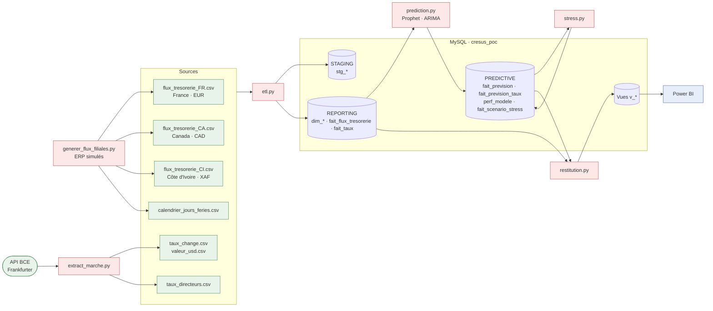
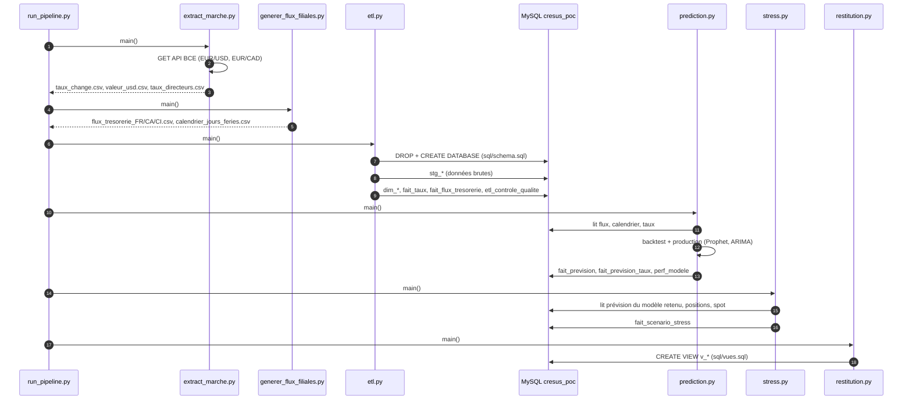
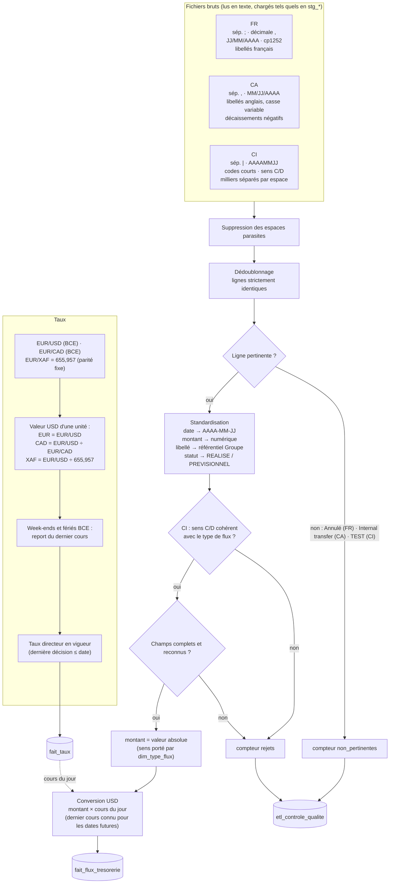
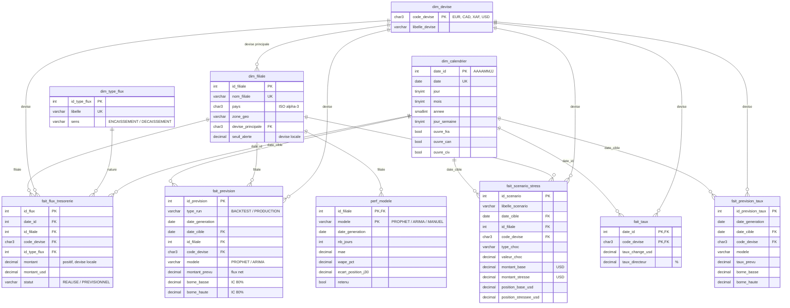
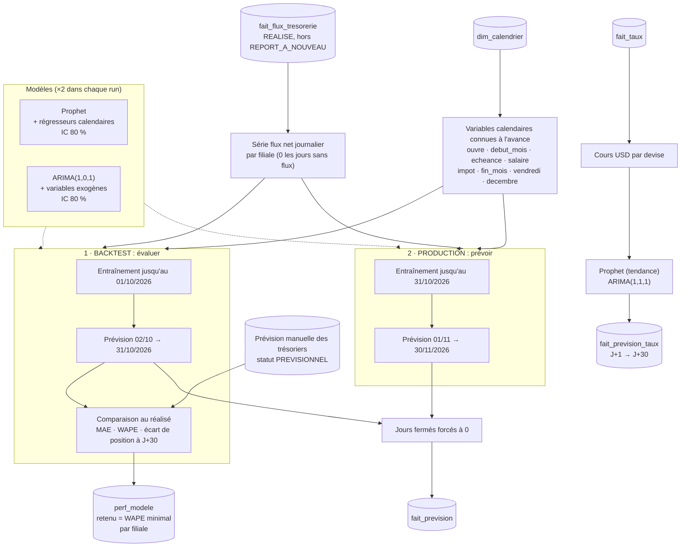
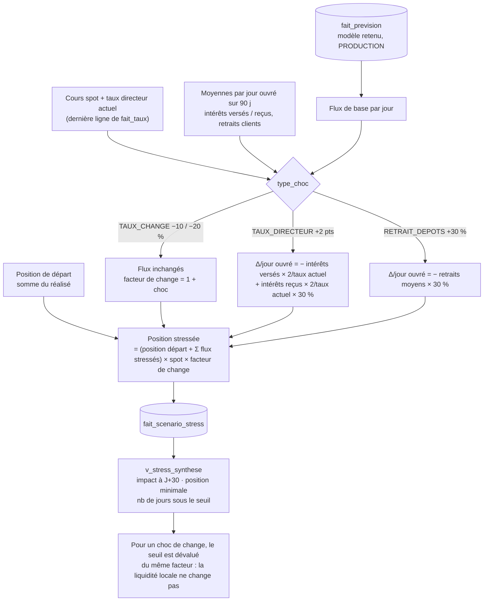
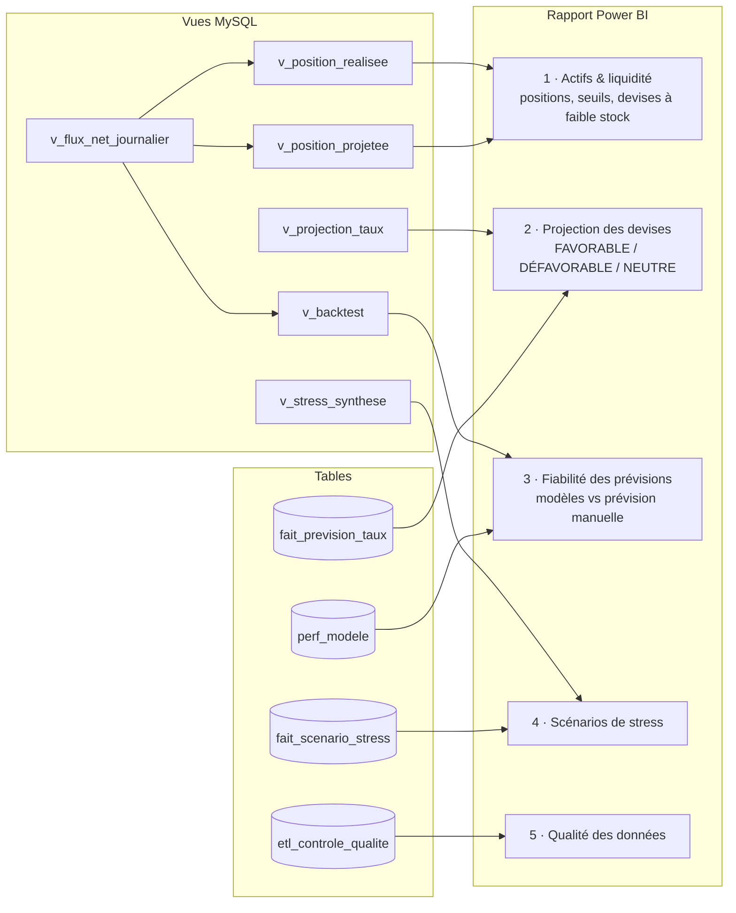

# Diagrammes du POC Crésus

1. [Architecture globale](#1-architecture-globale)
2. [Orchestration de la chaîne](#2-orchestration-de-la-chaîne)
3. [ETL : homogénéisation des sources](#3-etl--homogénéisation-des-sources)
4. [Modèle de données](#4-modèle-de-données)
5. [Moteur prédictif](#5-moteur-prédictif)
6. [Scénarios de stress](#6-scénarios-de-stress)
7. [Restitution Power BI](#7-restitution-power-bi)

---

## 1. Architecture globale

Les 5 étapes du MOE (§2.2) : sources → ETL → stockage → prédiction → restitution.

---

## 2. Orchestration de la chaîne

`run_pipeline.py` enchaîne les étapes ; `--sans-sources` saute les deux premières.

---

## 3. ETL : homogénéisation des sources

Chaque filiale a son propre format ; l'ETL les ramène à une structure commune.

---

## 4. Modèle de données

Constellation de faits partageant les dimensions (zone REPORTING + PREDICTIVE).

---

## 5. Moteur prédictif

Cible : **flux net journalier** (encaissements − décaissements) par filiale, horizon 30 jours.

---

## 6. Scénarios de stress

Appliqués à la prévision de production du **modèle retenu**, montants en USD au cours spot.

---

## 7. Restitution Power BI

Des tables et vues MySQL aux pages du rapport (MOE §2.2.5).

